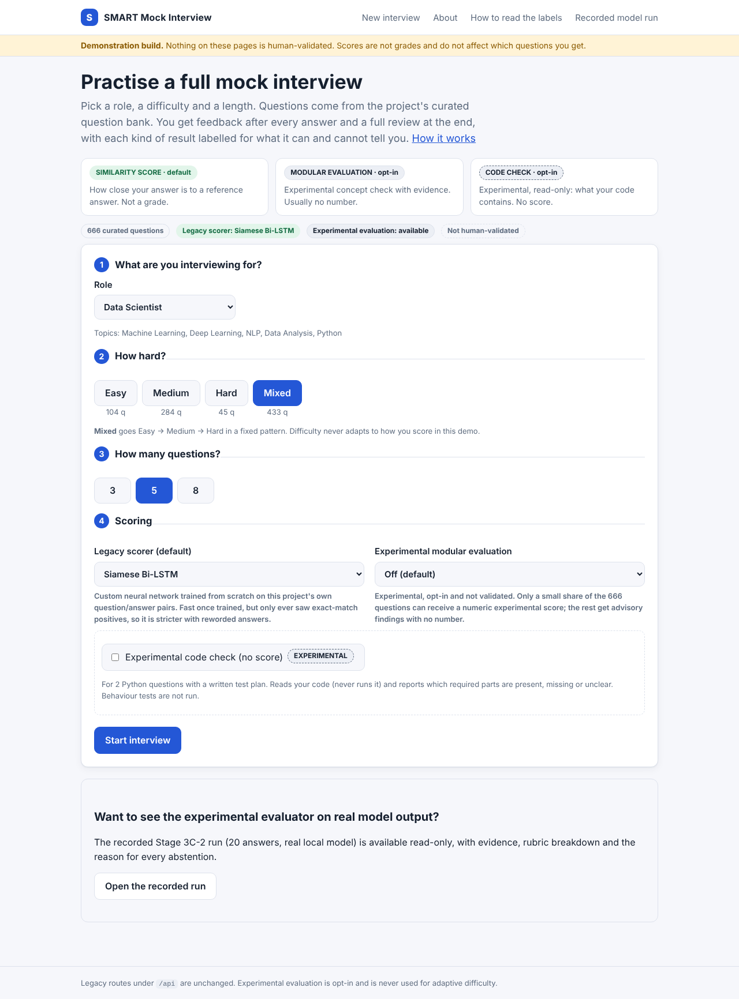

# SMART Mock Interview

A local practice tool for **technical interviews** (machine learning, deep learning, NLP, Python, SQL, data analysis) and a research prototype for evaluating free-text and code answers. You pick a role, difficulty and length, answer questions one at a time, and get per-question feedback and a session summary. Everything runs on your own computer.



> **Honest status.** This is a working demonstration, not a validated assessment tool. No score or finding in it has been checked against human marking. The default score measures **similarity to a reference answer**, not correctness. The experimental evaluators are opt-in, labelled, and never influence which question you get next. See [What is and is not established](#what-is-and-is-not-established).

## What is implemented

| Area | What exists | Where |
|---|---|---|
| Interview app (`/demo`) | A structured text interview: pick a role (optionally paste a job description), then introduction, five curated technical questions, up to two follow-ups, one practical exercise and a wrap-up; feedback report, JSON export, resume after refresh/restart, delete-my-data, About and label guide pages | `src/demo/` |
| Question bank | 666 curated records (487 frozen v5 + 179 approved expansion), each with a reference answer and key concepts; authored and source-checked with AI assistance (see `audit/`), **not human-reviewed**; loaded read-only with fingerprint checks | `src/retrieval/`, `data/` |
| Similarity scoring | Sentence-BERT (`all-MiniLM-L6-v2`) is the only scorer used for new interviews. The Siamese Bi-LSTM and TF-IDF scorers remain in `src/model/` as frozen research code and are not reachable from the interview | `src/model/` |
| Retrieval layer (the retrieval half of a RAG design) | Corpus loader, `all-MiniLM-L6-v2` (SentenceTransformer) embeddings, FAISS index, BM25 baseline and fallback, evaluation harness. Opt-in `/api/retrieval/*` routes, including (Stage 8B) `/api/retrieval/diagnostics`: scores, an uncalibrated evidence band, per-hit provenance and index/model fingerprints, never reference answers. **The interview app does not use vector search to choose questions, and nothing in the scoring path retrieves context at answer time: there is no retrieval-augmented grading yet.** | `src/retrieval/` |
| Experimental modular evaluation | Opt-in. A local LLM (Ollama, qwen2.5:7b) lists which required concepts an answer states, with quoted evidence; fixed rules build a rubric. The recorded run **failed its acceptance gate** (decision: *do not advance*) | `src/evaluation/`, `src/demo/experimental.py` |
| Experimental code check | Opt-in, two Python questions. Splits code from prose, parses the code (never runs it by default), reports requirements as found / missing / incorrect / unverified. No score. Optional sandboxed behaviour tests need Docker you set up yourself. Stage 8B adds a declarative JSON spec format so a third question needs data, not code ([docs/CODE_ASSESSMENT_SPECS.md](docs/CODE_ASSESSMENT_SPECS.md)); none is attached to a real question yet | `src/codeeval/` |
| Legacy app | The original adaptive Flask API (`/api/*`, 4,085-question knowledge base, PDF/e-mail reports) and its Node front end, unchanged | `main/`, `src/components/`, `frontend/` |

## What is implemented, what is experimentally verified, what is production-ready

| Capability | Implemented | Experimentally verified (and how) | Production-ready |
|---|---|---|---|
| Interview app, session persistence, deletion | yes | yes: tests + real Chromium run, 16/16 checks (Linux) | no: single-user local tool |
| Corpus loading and integrity (fingerprints, freeze, line endings) | yes | yes: tests; fresh-clone CI simulation | n/a |
| Semantic retrieval (MiniLM + FAISS) and BM25 fallback | yes | partly: relevance measured on AI-pooled labels (success@1 over answerable queries on the stored MiniLM `qk_concise` rankings: dev 0.71, frozen challenge 0.63); fallback tested | no: no human-labelled relevance set |
| Retrieval evidence band / provenance / diagnostics (8B) | yes | logic tested offline; the band catches 10/18 no-answer queries on the frozen challenge set, so it is a hint only | no |
| Key-concept reranker | tested, **not adopted** | no gain on the dev set (success@1 0.712 to 0.699) | no |
| Similarity scoring (default) | yes | runs; **not validated against human marking** | no |
| Experimental modular LLM evaluator | yes (opt-in) | failed its frozen gate (abstain 0.45 > 0.40); input safeguards tested with mock verifiers only | no |
| Experimental code check (static) | yes (opt-in, 2 questions + declarative format) | tests on fixtures | no |
| Sandboxed behaviour tests | yes (off by default) | by construction + unit tests; **not run against a real Docker daemon** | no: a container is not a hardened sandbox |
| MLflow tracking, historical import | yes | yes: 30 runs / 642 metrics reproduced exactly (Linux) | local only |
| DVC `build_index` | yes | yes with the offline stand-in embedder; not with the real MiniLM model | no remote configured |
| Docker / Compose | yes | built and run on Linux with a substitute Python base | no: no public deployment |
| GitHub Actions CI | yes | simulated locally from the hash locks; **never executed on GitHub** | no |
| Windows scripts | yes | run on Linux (PowerShell 7) only; **not run on Windows** | no |

Three kinds of result are always kept apart on screen: **similarity score** (default), **modular evaluation** (opt-in) and **code check** (opt-in). Nothing experimental controls adaptive difficulty. The demo itself does not adapt at all: Mixed goes Easy, Medium, Hard in a fixed pattern.

## Windows quick start

Prerequisites: Windows 10/11, **Python 3.10-3.12** (3.13 may lack wheels for some packages), Git. Docker Desktop and Ollama are optional.

```bat
git clone <your repository URL> SMART-MOCK-INTERVIEW
cd SMART-MOCK-INTERVIEW
python -m venv .bot
.bot\Scripts\activate
python -m pip install --upgrade pip
pip install -r requirements.txt
```

Then either double-click **`run_demo.bat`**, or:

```bat
.bot\Scripts\python.exe main\app.py
```

and open **http://127.0.0.1:5000/demo/** (the dashboard). The app binds to `127.0.0.1` only (this computer) and the Werkzeug debugger is off. What each screen does: [docs/FRONTEND.md](docs/FRONTEND.md).

Check your machine at any time (never trains, downloads or runs candidate code):

```bat
verify_windows.bat
```

It prints PASS / WARN / FAIL per check and says exactly how to fix each WARN. Options: `--url http://127.0.0.1:5000` (probe a running server), `--check-docker`, `--docker-sample`, `--check-ollama`, `--run-tests`.

### Model setup (nothing is downloaded or trained automatically)

The setup page shows which scorers are ready. A scorer that is not set up is shown as unavailable and the interview still works; it is never trained or downloaded during a web request.

| Scorer | Needs | One-time setup (run on purpose) |
|---|---|---|
| Sentence-BERT (the only scorer for new interviews) | `sentence-transformers`, model in the Hugging Face cache (about 90 MB) | `python src\model\Pretrained_NEURALN.py` (needs internet once) |

If Sentence-BERT is not set up, interviews still run and the similarity is reported as unavailable; no other scorer steps in. The older Siamese Bi-LSTM and TF-IDF scorers are kept only for the recorded experiments.

`SMART_DEMO_ALLOW_SCORER_SETUP=1` lets the demo set a missing scorer up on first use. It is off by default for exactly that reason.

## Features that are off by default

| Feature | Turn on | What changes |
|---|---|---|
| Experimental code check (read-only) | `set SMART_DEMO_CODE_EVAL=1` or `run_demo.bat --code-check` | A checkbox appears on the setup page. Code is parsed, **not run** |
| Sandboxed behaviour tests | also `set SMART_CODEEVAL_EXEC=docker` and build the image (below) | Tests run in a locked-down container if its self-test passes; otherwise still read-only |
| Experimental modular evaluation (real model) | `set SMART_DEMO_LIVE_MODULAR=1` or `run_demo.bat --live-model`, Ollama running with `qwen2.5:7b` | Slow (30-90 s per answer); a mock verifier mode also exists for testing the pipeline |
| Show reference answers | `set SMART_RETRIEVAL_EXPOSE_REFERENCE=1` | Reference answers appear in the summary |

Full list of variables: [docs/CONFIGURATION.md](docs/CONFIGURATION.md).

## Docker, MLflow, DVC, CI and monitoring (Stages 6B-7B)

```bat
copy .env.example .env
docker compose up --build                  :: app only, http://127.0.0.1:5000/demo/ (bound to this machine only)
docker compose --profile ollama up         :: + optional local Ollama service
python scripts\healthcheck.py --ready      :: health + readiness of a running instance
pip install -r requirements-mlops.txt
python scripts\mlflow_import_history.py    :: import existing results into local MLflow and verify them against the source files
mlflow ui --backend-store-uri sqlite:///mlflow/mlflow.db
verify_mlops.bat --check-docker --check-dvc :: read-only verification of this whole stage on your machine
powershell -ExecutionPolicy Bypass -File scripts\validate_windows.ps1 -Mlflow -Docker -Tests   :: all Stage 6C checks in one go
python scripts\verify_compose.py            :: Docker Desktop: build, start (127.0.0.1:5099), health, persistence, privacy, clean-up
python scripts\mlops_demo.py                :: 7-step walk-through of tracking, import, versioning, CI checks, health and metrics
python scripts\verify_dvc.py                :: DVC repro / status / checkout in a temporary copy (needs: pip install "dvc>=3,<4"); your repository is not touched
python scripts\check_staged.py --worktree   :: before publishing: nothing blocked, oversized, credential-shaped or personal in what would be committed
python scripts\check_versions.py           :: corpus, DVC params, served format, indexes, frozen files and stored results agree (read-only, no model)
python scripts\verify_real_index.py        :: real MiniLM index: cache, revision, checksums; add --build once to create the served-format index (offline)
python scripts\mlflow_track_retrieval.py --backend minilm --local-files-only   :: record a NEW retrieval evaluation in MLflow (refuses on a version mismatch)
python scripts\stage8_retrieval_probe.py --check  :: re-derive the stored-rankings probe (reranker, evidence band) and compare with the committed report
```

DVC (`dvc.yaml`, one stage) rebuilds the FAISS index and embedding cache from the frozen corpus after an integrity check; run `dvc init` once first (details and the remote-storage note: [docs/REPRODUCIBILITY.md](docs/REPRODUCIBILITY.md)).

The image is lean (no PyTorch, no model weights, no credentials), runs as a non-root user, and cannot execute candidate code. `/healthz`, `/readyz` and `/metrics` expose
privacy-safe counters; answers are never logged. CI is in `.github/workflows/` (normal pull-request checks need no GPU, Ollama, paid key or model download). **This is continuous integration only: no workflow deploys or publishes anything.**
Imported MLflow runs are labelled as historical imports and carry no accuracy claims. Details, verification status and public-deployment blockers:
[docs/MLOPS.md](docs/MLOPS.md), [docs/REPRODUCIBILITY.md](docs/REPRODUCIBILITY.md) and, before the first push to GitHub, [docs/GITHUB_FIRST_PUSH.md](docs/GITHUB_FIRST_PUSH.md).

## Documentation

- [docs/ARCHITECTURE.md](docs/ARCHITECTURE.md): components, data flow, the three result layers, retrieval, persistence
- [docs/CONFIGURATION.md](docs/CONFIGURATION.md): every environment variable and feature flag
- [docs/WALKTHROUGH.md](docs/WALKTHROUGH.md): a guided demonstration with screenshots
- [docs/TROUBLESHOOTING.md](docs/TROUBLESHOOTING.md): symptoms and fixes
- [docs/MLOPS.md](docs/MLOPS.md): MLflow tracking, CI, Docker, monitoring, local deployment, production limitations
- [docs/REPRODUCIBILITY.md](docs/REPRODUCIBILITY.md): integrity controls, line endings, locks, DVC scope, rebuilding the retrieval pipeline
- [docs/GITHUB_FIRST_PUSH.md](docs/GITHUB_FIRST_PUSH.md): exact first-push and first-CI-run procedure, findings, what can still fail
- [docs/CODE_EXECUTION_SECURITY.md](docs/CODE_EXECUTION_SECURITY.md): what the Docker interface does and does not guarantee
- [docs/CODE_ASSESSMENT_SPECS.md](docs/CODE_ASSESSMENT_SPECS.md): the layers of the code check and the declarative spec format
- [docs/EVALUATOR_VALIDATION_PROTOCOL.md](docs/EVALUATOR_VALIDATION_PROTOCOL.md): a proposed, not-yet-run human validation plan for the modular evaluator
- `reports/`: stage reports, including [Stage 5B/6A](reports/stage5b6a_consolidated_report.md), [Stage 6A/6B MLOps](reports/stage6ab_mlops_report.md) and [Stage 8A/8B](reports/stage8ab_consolidated_report.md)

## Tests

```bat
.bot\Scripts\python.exe -m pytest tests\evaluation tests\retrieval tests\app tests\codeeval tests\mlops -q
.bot\Scripts\python.exe scripts\check_integrity.py      :: dataset and frozen-experiment integrity (no drift expected)
```

Browser tests need `pip install playwright` and `playwright install chromium`:

```bat
python scripts\stage4a_demo_server.py --port 5058
python scripts\stage6a_browser_journey.py --base http://127.0.0.1:5058
```

`stage4a_demo_server.py` swaps in a transparent word-overlap stand-in for the scorer so the whole flow can be tested anywhere; its percentages are not real model scores.

## What is and is not established

**Established by tests and real-browser runs:** the interview flow end to end, indentation and code formatting preserved, candidate text escaped, session persistence and recovery, graceful behaviour when a scorer or code check fails, feature flags off by default, deletion.

**Also established (Stage 6B, Linux sandbox):** privacy-safe metrics and logs, `/healthz` `/readyz` `/metrics`, MLflow import reproducing 642 historical metrics exactly, the Docker image running non-root on a read-only filesystem with persistent sessions, a DVC stage that rebuilt the index with the offline dev-LSA stand-in embedder and restored it byte-identical (not run with the real MiniLM model).

**Not established:**
- That the GitHub workflows run green (never executed on GitHub; locally they were simulated on Python 3.12 from the hash-locked requirements), that `validate_windows.ps1` and the Windows launchers pass on a real Windows machine (they were only run on Linux), that the exact `python:3.13-slim` base builds (Docker Hub was unreachable in the sandbox; a substitute Python 3.13 base was used), or anything on Docker Desktop for Windows.
- That any score matches human judgement. The default scorers compare text with a reference answer; a correct answer in different words can score low, and for code the comparison is of text, not behaviour. The comment shown with a score depends only on the score band.
- That the modular evaluator is usable: the recorded 20-answer run had an abstain rate of 0.45 against a limit of 0.40.
- That code behaviour tests are safe against hostile code. A container shares the host's kernel; see the security document. The sandboxed path is checked by construction and unit tests only (it has not been run against a real Docker daemon by the author of this change); `verify_windows.bat --docker-sample` checks it on your machine. It has not had a security review.
- Retrieval benchmark labels are AI-generated, not human ground truth. The Stage 8B evidence band separates off-corpus queries imperfectly (4 of 18 frozen-challenge no-answer queries still look "adequate").
- That the Stage 8B evaluator safeguards improve grading. They close input-handling gaps (hidden instructions, truncated answers, a dead model server); they were tested with scripted verifiers, not measured on human labels.

## Legacy application

The original adaptive interview system (three scorers, adaptive Easy/Medium/Hard rounds, PDF and e-mail reports) lives in `main/` and `frontend/`; `run_all.bat` starts it together with Ollama and the comparison tool. It reads the 4,085-question processed knowledge base (Machine Learning 851, Deep Learning 710, NLP 649, Python 628, SQL 642, Data Analysis 605). The demo above uses the smaller curated corpus instead.

## Stage 11 follow-up engine (experimental, off by default)

An alternative follow-up engine where code owns the decision and the memory citation is documented in `docs/STAGE11_INTELLIGENCE_ARCHITECTURE.md`. Enable it only for evaluation with `SMART_DEMO_FOLLOWUP_ENGINE=objective`; the Stage 10N engine stays the default until the gates in that document are met on a real run.

## Author and license

**Mohan Ramamurthy**, MSc Data Science, University of Hertfordshire. MIT License (see `LICENSE`).
