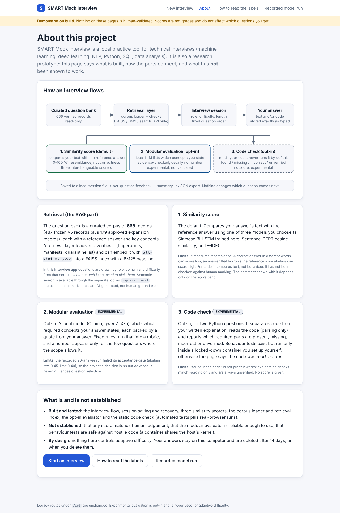
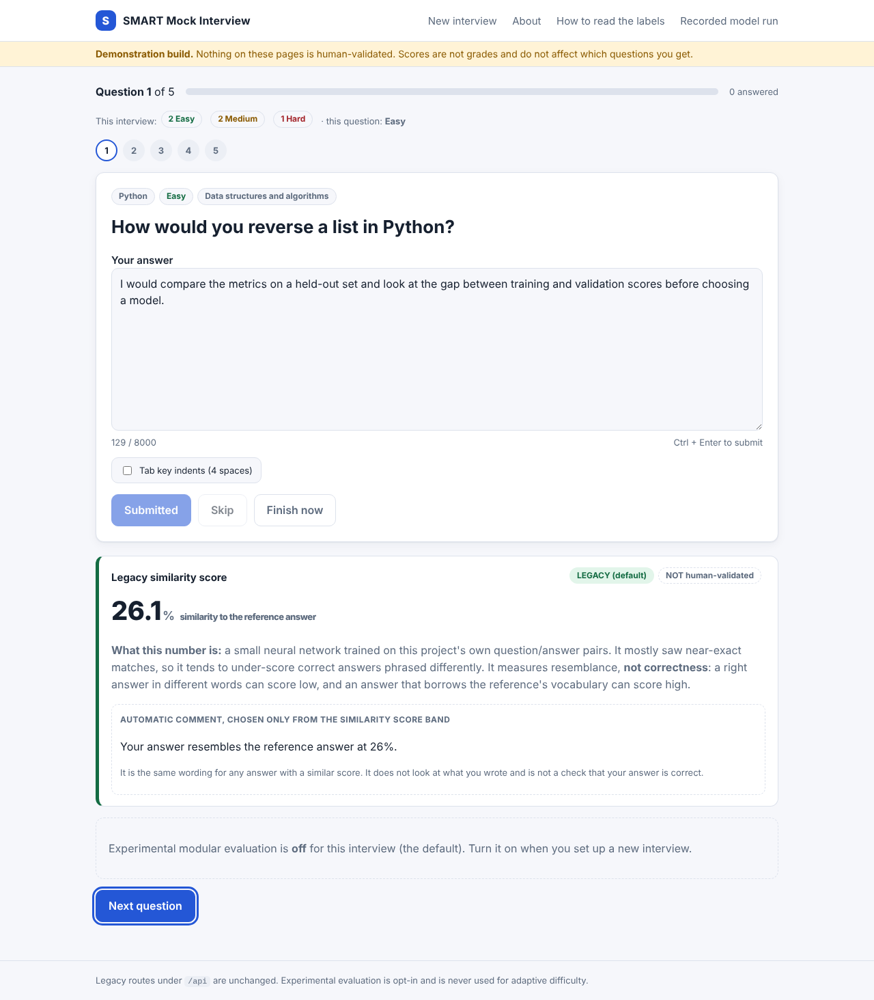
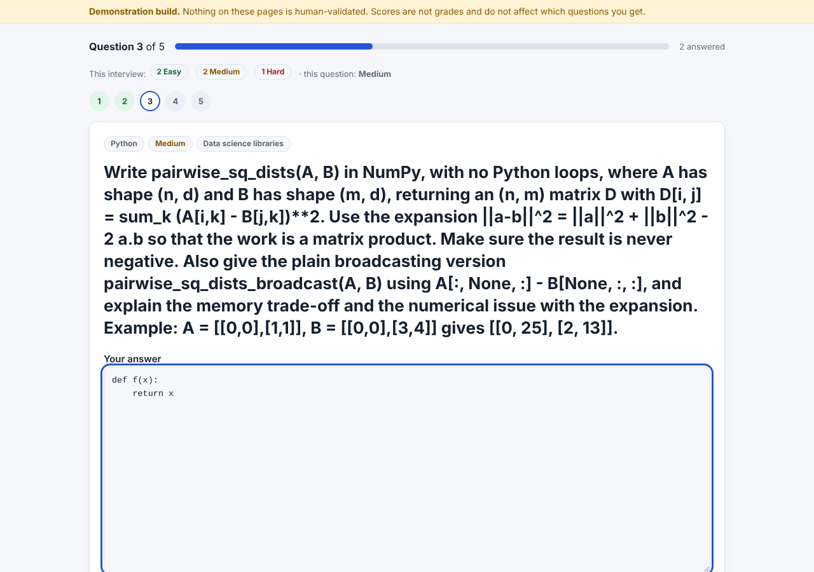
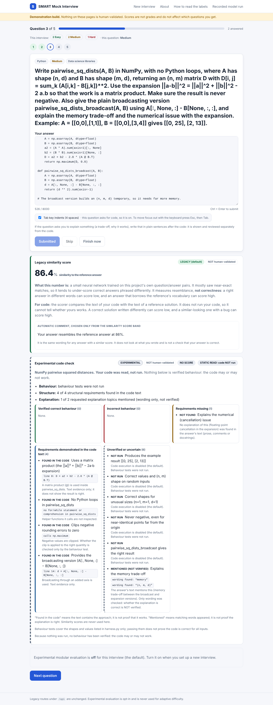
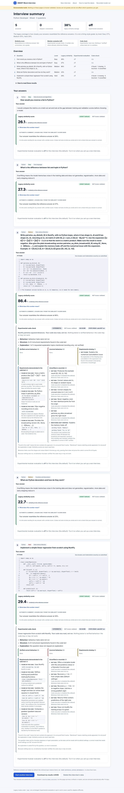
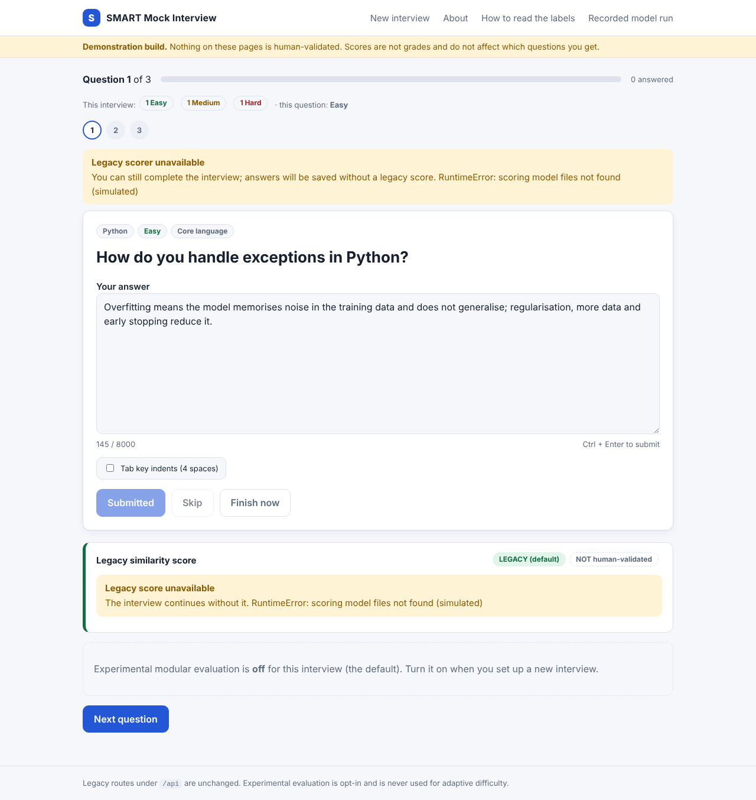
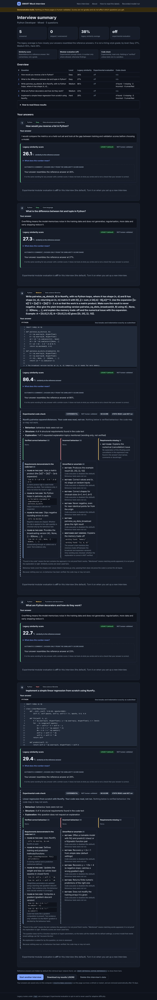

# Demonstration walkthrough

About ten minutes. Screenshots come from a real Chromium run against the app with a stand-in scorer (a word-overlap function), so the **percentages in them are not model scores**; the layout and labels are real.

Start: `run_demo.bat --code-check` (or `set SMART_DEMO_CODE_EVAL=1` then `python main\app.py`) and open http://127.0.0.1:5000/demo/.

## 1. Landing and setup

Point out the three result kinds shown side by side (similarity score, modular evaluation, code check), the "Not human-validated" chip, and the status chips: which scorer is ready. Choose *Python Developer*, *Mixed*, *5* questions, tick *Experimental code check* and *Prefer questions that have a code check*, then Start.

## 2. About page

Explains the data flow and what is and is not established. Use it to set expectations: the default score is similarity, vector search is not used to pick questions, the modular evaluator failed its acceptance gate, code is not run by default.

## 3. A prose question

Answer in your own words (Ctrl+Enter submits). The result card shows the similarity score with an explanation of what it measures, and an **Automatic comment** labelled as depending only on the score band. Nothing here claims the answer is correct.

## 4. A code question

The answer box is monospace with Tab = 4 spaces, Shift+Tab to outdent, auto-indent after a colon, and Esc then Tab to leave the box (keyboard users are never trapped). Paste or type the function, then add the written explanation after it as plain sentences or `#` comments.

## 5. The code check

Labelled **EXPERIMENTAL**, **NOT human-validated**, **NO SCORE** and, unless Docker execution is on, **STATIC READ: code NOT run**. Findings are in five groups: verified correct (empty when nothing ran), incorrect, missing, demonstrated in the code text, unverified. "Found in the code" means the text contains the approach, not that it works. A written explanation that mentions the right words is only "mentioned (not verified)".

## 6. Summary

Legend of the three kinds of result, an overview table with a code-check column, then each question with **its own** answer (code and prose shown separately, indentation exactly as typed) and feedback. "What does this number mean?" expands the full explanation. *Download my results (JSON)* exports everything with the same labels; *Delete this interview's data* erases the file.

## 7. Things worth showing
- Refresh the summary: identical. Close the browser mid-interview, reopen the setup page: a *Continue* card appears.
- Stop and restart the server: the saved interview is still there.
- Paste `` as an answer: it is displayed as text.
- Set a scorer that is not installed: the interview continues with "Legacy score unavailable".
- `/demo/recorded`: the recorded real-model experiment with its failed acceptance gate shown plainly.

