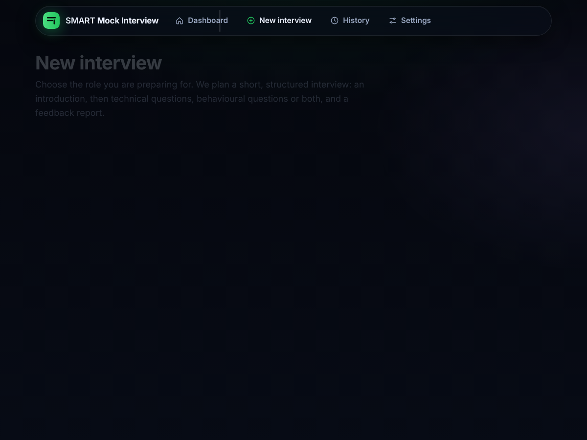
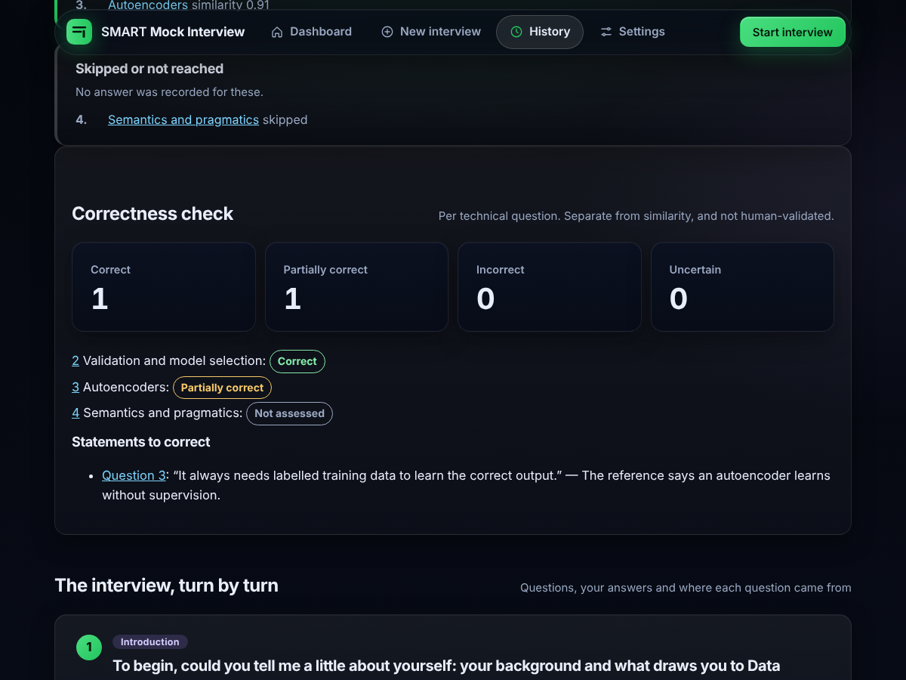
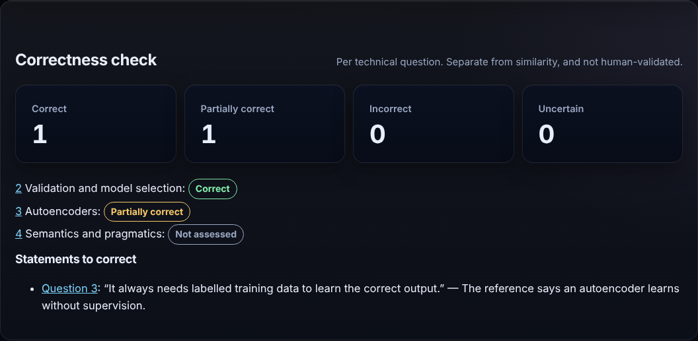
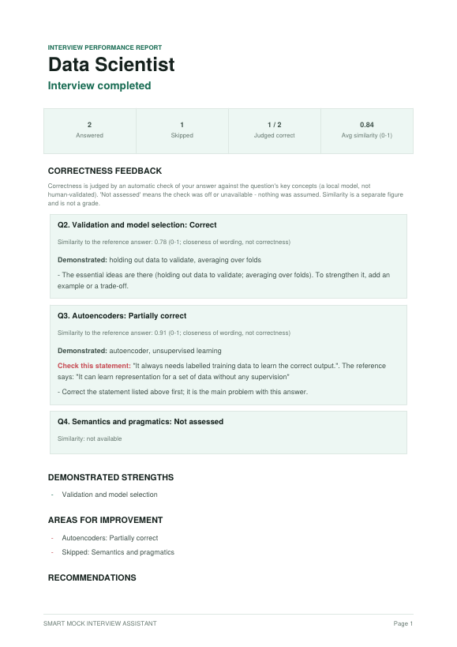
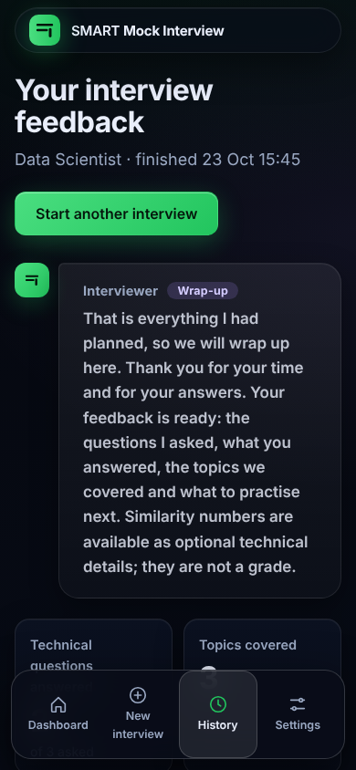

# Demonstration walkthrough

About ten minutes. Screenshots come from the running app (Chromium). The **correctness verdicts in them are illustrative**: they were produced from scripted evaluator replies, not a live model, so they show the layout and wording, not model accuracy. Similarity values in them come from the test-suite stand-in scorer.

Start: `run_demo.bat` (add `--live-model` to turn the correctness check on; it needs Ollama with `qwen2.5:7b`). Open http://127.0.0.1:5000/ , which sends a browser to `/demo/`.

## 1. Setup

Pick a role, the interview type (technical, behavioural or mixed), the length (15, 30, 45 or 60 minutes) and optionally paste a job description. The length is a time budget, not a hard timer: once it is used up the interviewer wraps up instead of starting new follow-ups.

## 2. The interview
Answer one turn at a time (Ctrl+Enter submits). Every technical answer shows two separate panels: a **Correctness check** (Correct / Partially correct / Incorrect / Uncertain, with correct and missing concepts and any statement the reference contradicts) and the **similarity value** on a 0-1 scale with an explanation that it is not a grade. If the concept check is off, the first panel says *Not assessed*; nothing is invented. You can skip a question, refresh, or close the browser and continue later from the dashboard.

## 3. Summary and PDF

The summary has a Correctness check section (counts, one verdict per question, "Statements to correct"), the topics covered, areas for practice and every turn with its answer. **Download PDF report** builds the PDF with the same correctness feedback; **Download my results (JSON)** gives the data.

## 4. Other things worth showing
- Refresh the summary: identical. Stop and restart the server: the saved interview is still there (History page).
- Paste `` as an answer: it is displayed as text.
- `/demo/recorded`: the recorded real-model experiment with its failed acceptance gate shown plainly.
- Narrow screens:

Earlier screenshots in `docs/screenshots/` (numbered `01`-`15`) predate Stage 12 and show the old percentage display; they are kept for history only and are not used in the documentation.
